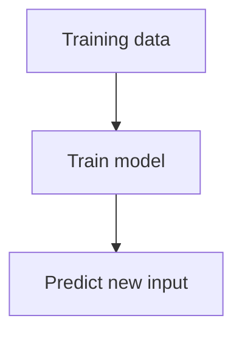

<!--
  TEMPLATE FOR NEW NOTES. Copy this file, then delete what you don't need.

  Frontmatter for a real note (remove nav_exclude / search_exclude):
    title:        shown in the sidebar, with its number, quoted: "3.4 Gradient Descent"
    parent:       the numbered TITLE of the section page, quoted: "3 Linear Regression"
    grand_parent: the TITLE of the subject page: Machine Learning
    nav_order:    position in the sidebar
  Put the same number in the # heading, and add the page to its section's index.md.
  The file's location is its URL: machine-learning/linear-regression/foo.md
  -> /machine-learning/linear-regression/foo/

  These HTML comments don't show up on the site.
-->

# Example Note

One line on what this is, in plain words.

## Quick summary

- Short bullets.
- The one idea to remember.

<!-- IMAGE: keep it next to the note, name it fig-N-topic.png, use the full path. -->


## Table

| Size (sq ft) | Price ($1,000s) |
| --- | --- |
| 500 | 100 |
| 800 | 150 |

## Math

<!--
  MATH: always $$...$$, never \( \).
  Inline: put it inside a sentence. Display: $$ on its own lines with blank lines around.
-->

The model predicts $$\hat{y}$$ from $$x$$. For one training example:

$$
f_{w,b}(x^{(i)}) = w x^{(i)} + b
$$

## Diagram

<!-- MERMAID: a ```mermaid code block. Prefer flowchart TB so it stays readable on a phone. -->



## Runnable Python

<!--
  RUNNABLE CODE: a ```python block with {: .runnable} on the very next line.
  Tapping Run downloads Python once (~25 MB), then runs in the browser.
  numpy, pandas, matplotlib and scikit-learn work. PyTorch/TensorFlow don't.
  Blocks on the same page share variables, like notebook cells.
  A ```python block without {: .runnable} is just a normal code block.
-->

Tap **Run** to try it. The first run takes a while because it downloads Python.

```python
import numpy as np

sizes = np.array([500, 800, 1200, 1500, 2000, 2500])
prices = np.array([100, 150, 170, 230, 300, 350])

w, b = np.polyfit(sizes, prices, 1)
print(f"w = {w:.3f}, b = {b:.1f}")
print(f"Predicted price for 750 sq ft: ${w * 750 + b:.0f}K")
```
{: .runnable}

This block uses `sizes`, `prices`, `w` and `b` from the one above, so run that first:

```python
import matplotlib.pyplot as plt

plt.scatter(sizes, prices, marker="x", color="red", label="Training data")
plt.plot(sizes, w * sizes + b, label="Model")
plt.xlabel("Size (sq ft)")
plt.ylabel("Price ($1,000s)")
plt.legend()
plt.show()
```
{: .runnable}

A normal, non-runnable code block:

```bash
docker restart thm-jekyll-local
```

## Collapsible section

<!-- DETAILS: hide long reference material. markdown="1" lets Markdown work inside. -->

<details markdown="1">
<summary>Tap to expand</summary>

| Term | Meaning |
| --- | --- |
| $$x$$ | Input |
| $$y$$ | Target |

</details>

## Remember

- One bullet per thing worth remembering.
- **Bold** only the key term.
