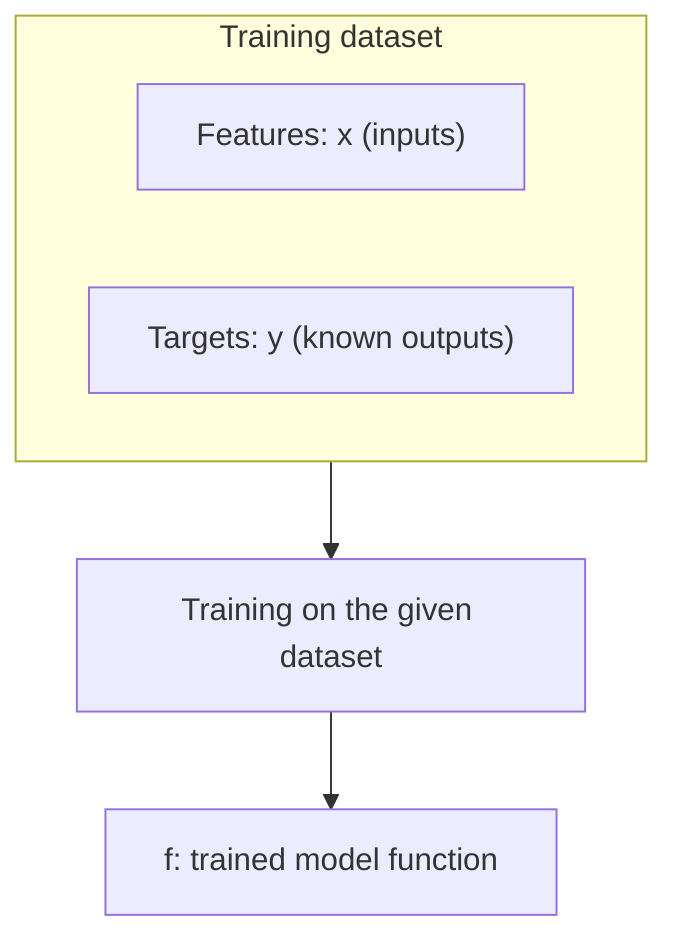
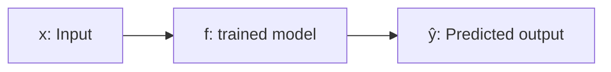

# From Data to a Model Function

A graph helps us see how $$y$$ changes as $$x$$ changes. We will use this to understand how a trained model produces predictions.

If you are already familiar with graphs and plotting, you can skip to **From a formula to a function**. Otherwise, open the introduction below.

<details markdown="1">
<summary>Getting started with graphs and plotting</summary>

## 1. When y equals x

Our first rule is:

$$
y = x
$$

Whatever number we give as $$x$$, we get the same number as $$y$$.

| x | y |
|---:|---:|
| 0 | 0 |
| 1 | 1 |
| 2 | 2 |
| 3 | 3 |
| 4 | 4 |

**Click Run to see the graph.** The first run may take a little while to load Python.

```python
import numpy as np
import matplotlib.pyplot as plt

x = np.array([0, 1, 2, 3, 4])

plt.figure(figsize=(6, 4))
plt.plot(x, x, color="blue", label="y = x")
plt.scatter(x, x, color="red", zorder=3, label="Table values")
plt.xlabel("x")
plt.ylabel("y")
plt.xticks(x)
plt.yticks(x)
plt.grid(alpha=0.3)
plt.legend()
plt.show()
```
{: .runnable}

### Reading the graph

The graph has two numbered directions:

- **Across the bottom**, we have $$x$$. This is the horizontal axis.
- **Up the side**, we have $$y$$. This is the vertical axis.

Each red dot represents one row from our table.

Let's take the **third data row**, where $$x = 2$$ and $$y = 2$$:

1. Start at $$(0, 0)$$, where both values are zero.
2. Since **x is 2**, move **2 units to the right**, stopping at 2 on the horizontal axis.
3. Since **y is 2**, move **2 units up** from there.
4. Put a dot at that spot.

That dot represents the pair $$(2, 2)$$.

We do the same for every row. Because $$y$$ always equals $$x$$, each step of 1 to the right comes with a step of 1 up. The dots line up along a **straight line**.

We also draw a line through the dots. Our rule works between the table values too: when $$x = 1.5$$, $$y = 1.5$$.

## 2. When y is double x

Now change the rule to:

$$
y = 2x
$$

This means **multiply the input by 2** to get the output.

| x | y |
|---:|---:|
| 0 | 0 |
| 1 | 2 |
| 2 | 4 |
| 3 | 6 |
| 4 | 8 |

**Click Run to see the graph.** Run the first example above before this one.

```python
plt.figure(figsize=(6, 4))
plt.plot(x, x, color="green", label="Previous: y = x")
plt.plot(x, 2 * x, color="blue", label="New: y = 2x")
plt.scatter(x, 2 * x, color="red", zorder=3, label="New table values")
plt.xlabel("x")
plt.ylabel("y")
plt.xticks(x)
plt.yticks(range(9))
plt.grid(alpha=0.3)
plt.legend()
plt.show()
```
{: .runnable}

The **green line** shows our previous rule, $$y = x$$. The **blue line and red dots** show the new rule, $$y = 2x$$.

Let's take the third data row again. This time, $$x = 2$$ and $$y = 4$$:

1. Start at $$(0, 0)$$.
2. Move **2 units right**, because $$x = 2$$.
3. Move **4 units up**, because $$y = 4$$.
4. Put a dot there.

For the same input of 2, the old rule gives us 2, while the new rule gives us 4. So the new dot sits higher.

Each time $$x$$ increases by 1, $$y$$ now increases by 2. This makes the new line **steeper** than the old one.

We call this rate of change the **slope**:

- For $$y = x$$, the slope is **1**.
- For $$y = 2x$$, the slope is **2**.

Both rules produce straight lines, so both are **linear**.

## 3. When y is x squared

Now try:

$$
y = x^2
$$

Squaring means **multiplying the input by itself**. For example, $$3^2 = 3 \times 3 = 9$$.

| x | y |
|---:|---:|
| 0 | 0 |
| 1 | 1 |
| 2 | 4 |
| 3 | 9 |
| 4 | 16 |

**Click Run to compare all three rules.** Run the first example above before this one.

```python
smooth_x = np.linspace(0, 4, 100)

plt.figure(figsize=(6, 4))
plt.plot(smooth_x, smooth_x, color="green", label="y = x")
plt.plot(smooth_x, 2 * smooth_x, color="blue", label="y = 2x")
plt.plot(smooth_x, smooth_x ** 2, color="orange", label="y = x²")
plt.scatter(x, x ** 2, color="red", zorder=3, label="New table values")
plt.xlabel("x")
plt.ylabel("y")
plt.xticks(x)
plt.yticks(range(0, 17, 2))
plt.grid(alpha=0.3)
plt.legend()
plt.show()
```
{: .runnable}

The **orange curve and red dots** show our new rule, $$y = x^2$$.

For example, the fourth data row has $$x = 3$$ and $$y = 9$$. We place its dot by moving **3 units right** from $$(0, 0)$$, then **9 units up**.

This time, the dots do not form a straight line.

Look at how much $$y$$ increases each time $$x$$ increases by 1:

- From 0 to 1: it increases by **1**.
- From 1 to 4: it increases by **3**.
- From 4 to 9: it increases by **5**.
- From 9 to 16: it increases by **7**.

The output grows by larger amounts, so the curve gets steeper as we move right. The rate of change is not constant. This relationship is **nonlinear**.

The code calculates extra points between our table values to draw the curve smoothly.

### What to take from these examples

- Each dot represents one pair of values: $$(x, y)$$.
- Read $$x$$ horizontally and $$y$$ vertically.
- A straight line has a constant slope.
- Our lines and curve follow rules we already know. Collected data may not follow such a neat pattern.

</details>

## From a formula to a function

We have already seen that $$x$$ is the input and $$y$$ is the output.

Let's try this rule:

$$
y = x^3
$$

This means we multiply the input by itself three times. For example, if $$x = 2$$:

$$
y = 2 \times 2 \times 2 = 8
$$

| Input: x | Output: y |
|---:|---:|
| 0 | 0 |
| 1 | 1 |
| 2 | 8 |
| 3 | 27 |
| 4 | 64 |

**Click Run to see the graph.** You can run this block directly, even if you skipped the introduction.

```python
import numpy as np
import matplotlib.pyplot as plt

x = np.array([0, 1, 2, 3, 4])
smooth_x = np.linspace(0, 4, 100)

plt.figure(figsize=(6, 4))
plt.plot(smooth_x, smooth_x ** 3, label="y = x³")
plt.scatter(x, x ** 3, color="red", marker="x", zorder=3,
            label="Table values")
plt.xlabel("x")
plt.ylabel("y")
plt.grid(alpha=0.3)
plt.legend()
plt.show()
```
{: .runnable}

Each red cross represents one row from our table. The curve passes through every point because we calculated every output using the same rule.

## What does f(x) mean?

We can give this rule a name, such as **f**, and write:

$$
f(x) = x^3
$$

Read $$f(x)$$ as **“f of x.”** It means the output of the function named $$f$$ when we give it the input $$x$$.

Think of the function as a machine:

- We give it a number.
- It follows its rule: multiply that number by itself three times.
- It gives us the result.

For an input of 2:

$$
f(2) = 2 \times 2 \times 2 = 8
$$

Here, **2 is the input**, and **8 is the output**.

The expression on the right, $$x^3$$, tells us **how to calculate the output**. The expression on the left, $$f(x)$$, names that output.

So we can write:

$$
y = f(x) = x^3
$$

## What if the points do not follow an exact rule?

In our previous examples, we chose a rule first and used it to calculate the data points. So every point sat exactly on its line or curve.

In real life, we often start with **collected data**, and we want to find a rule that describes its pattern.

For example, suppose we collected these values:

| Input: x | Observed output: y |
|---:|---:|
| 0.5 | 2 |
| 1 | 1 |
| 1.5 | 2.8 |
| 2 | 2.3 |
| 2.5 | 4 |
| 3 | 3.5 |

**Click Run to plot the data and a straight line fitted to it.** This block can run independently.

```python
import numpy as np
import matplotlib.pyplot as plt

x = np.array([0.5, 1, 1.5, 2, 2.5, 3])
y = np.array([2, 1, 2.8, 2.3, 4, 3.5])

slope, intercept = np.polyfit(x, y, 1)
line_x = np.linspace(0, 3.5, 100)
line_y = slope * line_x + intercept

plt.figure(figsize=(6, 4))
plt.scatter(x, y, color="red", marker="x", s=70,
            label="Collected data", zorder=3)
plt.plot(line_x, line_y, color="blue",
         label="Linear regression")
plt.xlabel("x")
plt.ylabel("y")
plt.grid(alpha=0.3)
plt.legend()
plt.show()
```
{: .runnable}

The red crosses are scattered. They do not sit exactly on one straight line.

For example, when $$x = 0.5$$, the observed output is 2. But when $$x = 1$$, the output drops to 1. Still, looking at all the points, we can see a general pattern: **larger inputs tend to have larger outputs**.

The blue line describes that overall trend. It does not need to pass through every point.

This is the idea behind **linear regression**: find a straight line whose predictions fit the observed values well overall.

In this example, the fitting method chooses the line by minimizing the sum of the squared vertical gaps between the points and the line. We will explore that calculation later.

## From a training dataset to a function

Earlier, we wrote the rule ourselves:

$$
f(x) = x^3
$$

With collected data, we may not know which numbers to put in the rule.

For linear regression, we choose a **straight-line rule**. A learning algorithm then trains on our dataset to find the numbers that make the line fit the data well.

Our training dataset contains both:

- **Features:** the input values, $$x$$.
- **Targets:** the known output values, $$y$$.



The result is a **trained model function**, $$f$$. In our example, this function is represented by the blue line.

## Using the trained function

Now let's take the function $$f$$ from the training diagram and use it.

We give it an input, $$x$$, and it produces a predicted output, $$\hat{y}$$.



Training uses examples containing both inputs and known targets. After training, we can give the function an input without supplying its target.

## Why do we write y hat?

The symbol $$\hat{y}$$ is read as **“y hat.”** It represents the model's predicted output.

- $$y$$ is the **observed target value** in our data.
- $$\hat{y}$$ is the **prediction** produced by the model.

So we write:

$$
\hat{y} = f(x)
$$

Let's go back to our scattered-data table. When $$x = 2$$, the observed value is:

$$
y = 2.3
$$

But the blue line sits at approximately 2.83 when $$x = 2$$. So our model predicts:

$$
\hat{y} = f(2) \approx 2.83
$$

To see this on the graph:

1. Find **2 on the horizontal axis**.
2. Move straight up until you reach the **blue line**.
3. Read the height of the line using the vertical axis.

That height is the prediction. The red cross at the same input shows the observed value, 2.3.

We use different symbols because these values have different roles. A prediction can match an observed value, but it does not have to.

### Back to house prices

Suppose we train a model using house sizes and their known prices.

After training, we give the model a house size, and it predicts a price:

- $$x$$: the house size.
- $$f$$: the trained model function.
- $$\hat{y}$$: the predicted price.

If we also know the house's actual price, that is $$y$$. We can compare it with $$\hat{y}$$ to see how close the prediction is.

This is the basic idea of **supervised learning**: learn from examples containing inputs and known targets, then use the trained model to predict outputs.

## What is the function for our straight line?

For linear regression with one input feature, we use:

$$
f(x) = wx + b
$$

This tells us to:

1. Take the input $$x$$.
2. Multiply it by $$w$$.
3. Add $$b$$.
4. Return the result as the prediction.

The values $$w$$ and $$b$$ are called **parameters**. Training finds their values.

Once training is finished, they stay fixed while we use the model to make predictions. The input $$x$$ can change from one prediction to the next.

For example, suppose a trained model has:

$$
w = 2,\qquad b = 1
$$

Its function is:

$$
f(x) = 2x + 1
$$

For an input of 3:

$$
\hat{y} = f(3) = 2 \times 3 + 1 = 7
$$

These are example parameter values, rather than the values fitted in our earlier graph.

## What do w and b control?

### w controls the slope

$$w$$ tells us how much the prediction changes when $$x$$ increases by 1.

In our example, $$w = 2$$. Every increase of 1 in the input increases the prediction by 2.

Changing $$w$$ changes the line's slope.

### b controls where the line crosses the vertical axis

When $$x = 0$$:

$$
f(0) = w \times 0 + b = b
$$

So $$b$$ is the predicted output when the input is zero. It is also called the **intercept**.

In our example, $$b = 1$$, so the line crosses the vertical axis at 1.

Changing $$b$$ shifts the whole line up or down.

## Writing the parameters in the function's name

To show explicitly that the function depends on the chosen parameters, we can write:

$$
f_{w,b}(x) = wx + b
$$

The small $$w,b$$ below the $$f$$ identify the parameters used by this function. The $$x$$ inside the brackets is the input.

Putting everything together:

$$
\hat{y} = f_{w,b}(x) = wx + b
$$

Training finds $$w$$ and $$b$$. Those values define the line. For any input $$x$$, the formula gives the height of that line, which is our prediction.

## Remember

- $$f(x)$$ means the **output of function f for input x**.
- Our training dataset contains **features** and **known targets**.
- Training produces a **model function** that we can use for predictions.
- $$y$$ is an **observed target**; $$\hat{y}$$ is a **prediction**.
- For linear regression with one input, $$\hat{y} = wx + b$$.
- **w** controls the slope; **b** controls the vertical intercept.
- Training finds these parameters. They stay fixed when we use the trained model.
- Every prediction lies on the model's line, even when the observed data points do not.