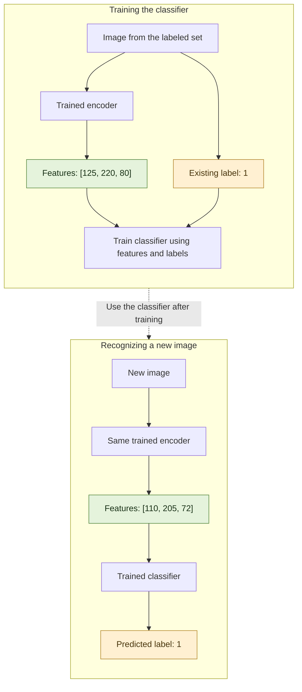

<style>
.dr-term {
  appearance: none;
  display: inline;
  padding: 0;
  margin: 0;
  border: 0;
  border-bottom: 1px dotted currentColor;
  border-radius: 0;
  background: transparent;
  color: inherit;
  font: inherit;
  line-height: inherit;
  cursor: help;
}

.dr-term:focus-visible {
  outline: 2px solid currentColor;
  outline-offset: 3px;
}

.dr-definition {
  box-sizing: border-box;
  width: min(90vw, 30rem);
  max-height: 80vh;
  overflow: auto;
  padding: 1.25rem;
  border: 1px solid #888;
  border-radius: 0.6rem;
  background: Canvas;
  color: CanvasText;
  font-size: 1rem;
  line-height: 1.6;
  box-shadow: 0 0.5rem 2rem #0003;
}

.dr-definition::backdrop {
  background: #0002;
}

.dr-definition p {
  margin: 0 0 1rem;
}

.dr-definition button {
  padding: 0.3rem 0.7rem;
  border: 1px solid currentColor;
  border-radius: 0.3rem;
  background: transparent;
  color: inherit;
  font: inherit;
  cursor: pointer;
}

.dr-swatch {
  display: inline-block;
  width: 4em;
  height: 1.2em;
  border: 1px solid #777;
  vertical-align: middle;
}
</style>

# Dimensionality Reduction

Hover over a dotted term for a quick reminder. On mobile, tap it to open the explanation. Tap outside the explanation or press **Close** to dismiss it.

## Quick summary

- A **dimension** is an input feature: one value used to describe an example.
- Dimensionality reduction describes an example using **fewer values**, while keeping useful information.
- Those new values can become the input of another model.
- **Unsupervised means no target answers are supplied during learning. It doesn't mean there is no output.**

## Example: recognizing just 0, 1, and 2

We are building a model to recognize **three digits: 0, 1, and 2**. A full digit recognizer would handle 0–9, but keeping just three makes this example easier to trace mentally.

Imagine we collect **1,000 grayscale images of each digit**: 3,000 images altogether, with variations in font, size, and position. Only a few have <button type="button" class="dr-term" popovertarget="dr-label" title="A known answer attached to a training example, such as: this image contains 1.">labels</button>.

What does **labeled** mean? Out of the 1,000 images containing 1, suppose only ten have an answer attached saying **“This image contains the digit 1.”** We also have ten labeled examples of 0 and ten of 2.

That gives us **30 labeled images**. The remaining images have no digit answer attached.

Each image is **64 × 64 pixels**, giving us:

**64 × 64 = 4,096 pixels. Each pixel's brightness value is one input feature.**

Our goal is to describe each image using **fewer than 4,096 values**, then use that smaller description to recognize the digit.

## Step 1: reduce the features

Reducing features doesn't necessarily mean creating a smaller image. To the model, a grayscale image is a collection of numbers, and the compressed output can also be a collection of numbers.

We train a model called an **autoencoder** using all 3,000 images, without giving it their digit labels.

It learns to compress each image into a short list of numbers, then tries to **rebuild the original image from that list**. Comparing the rebuilt image with the original helps it learn what information to keep.

For example, we could choose a <button type="button" class="dr-term" popovertarget="dr-description" title="A shorter list of numbers describing one image. It is the encoder's output and later becomes the classifier's input.">compressed representation</button> containing 100 numbers:

```text
[0.01, 0.11, ...]  ← 100 numbers altogether
```

These are learned numerical features. They aren't random values, even though their meaning might not be obvious to us.

An autoencoder has two parts:

- **Encoder:** turns the original image into the smaller representation.
- **Decoder:** tries to rebuild the original image from that representation.

After training, we use the **encoder** to generate the features for our classifier.

### Make the output easier to picture

To help us trace the example mentally, let's use **three numbers instead of 100**:

```text
[num1, num2, num3]
```

For this example, we design each value to stay between **0 and 255**, so we can display the output as an **RGB color**:

- `num1`: red
- `num2`: green
- `num3`: blue

**One image → 4,096 pixel values → 3 learned features**

The color is just a way for us to view those three features. The model isn't trying to choose a color or predict a digit label.

Think of it as a compressor learning to keep information useful for rebuilding the image. We then use that smaller description as input to the classifier.

### Five different images of 0

Suppose five images containing the digit 0 produce these outputs:

| Input image | Compressed features | Displayed as RGB |
| --- | --- | --- |
| Image 1 of digit 0 | `[150, 45, 55]` | <span class="dr-swatch" style="background-color:rgb(150,45,55);"></span> |
| Image 2 of digit 0 | `[180, 55, 65]` | <span class="dr-swatch" style="background-color:rgb(180,55,65);"></span> |
| Image 3 of digit 0 | `[210, 70, 80]` | <span class="dr-swatch" style="background-color:rgb(210,70,80);"></span> |
| Image 4 of digit 0 | `[230, 100, 110]` | <span class="dr-swatch" style="background-color:rgb(230,100,110);"></span> |
| Image 5 of digit 0 | `[245, 135, 145]` | <span class="dr-swatch" style="background-color:rgb(245,135,145);"></span> |

The colors differ, but they all look like shades of red.

### Five different images of 1

Now suppose five images containing the digit 1 produce:

| Input image | Compressed features | Displayed as RGB |
| --- | --- | --- |
| Image 1 of digit 1 | `[45, 130, 40]` | <span class="dr-swatch" style="background-color:rgb(45,130,40);"></span> |
| Image 2 of digit 1 | `[65, 160, 50]` | <span class="dr-swatch" style="background-color:rgb(65,160,50);"></span> |
| Image 3 of digit 1 | `[90, 190, 65]` | <span class="dr-swatch" style="background-color:rgb(90,190,65);"></span> |
| Image 4 of digit 1 | `[125, 220, 80]` | <span class="dr-swatch" style="background-color:rgb(125,220,80);"></span> |
| Image 5 of digit 1 | `[160, 240, 115]` | <span class="dr-swatch" style="background-color:rgb(160,240,115);"></span> |

These are visibly different shades of green.

### Five different images of 2

Finally, five images containing the digit 2 might produce:

| Input image | Compressed features | Displayed as RGB |
| --- | --- | --- |
| Image 1 of digit 2 | `[40, 65, 145]` | <span class="dr-swatch" style="background-color:rgb(40,65,145);"></span> |
| Image 2 of digit 2 | `[50, 85, 175]` | <span class="dr-swatch" style="background-color:rgb(50,85,175);"></span> |
| Image 3 of digit 2 | `[65, 105, 205]` | <span class="dr-swatch" style="background-color:rgb(65,105,205);"></span> |
| Image 4 of digit 2 | `[90, 135, 230]` | <span class="dr-swatch" style="background-color:rgb(90,135,230);"></span> |
| Image 5 of digit 2 | `[125, 165, 250]` | <span class="dr-swatch" style="background-color:rgb(125,165,250);"></span> |

These look like different shades of blue.

### What do these colors mean?

Different images produce different numerical descriptions. Similar images can share visual patterns, so the model may learn similar descriptions for them.

**The numbers and color families above are chosen to illustrate the idea.** In practice, we choose the representation size and train the model to preserve useful image information; digit labels don't determine its colors.

It also doesn't give every image of 1 the same code. **Each array describes one image.** It isn't a name assigned to a cluster.


## Step 2: teach a classifier what the features mean

Remember those **ten labeled images of each digit**? We now pass those 30 images through the encoder we just trained.

Since we already know their labels, we can keep each original label attached to the resulting three numbers.

For example:

```text
Original image: an image labeled 1
Encoder's compressed output: [125, 220, 80]

Classifier training pair:
Input: [125, 220, 80]
Label: 1
```

A few training pairs might look like this:

| Compressed features given to the classifier | Color preview | Original digit label |
| --- | --- | --- |
| `[180, 55, 65]` | <span class="dr-swatch" style="background-color:rgb(180,55,65);"></span> | **0** |
| `[210, 70, 80]` | <span class="dr-swatch" style="background-color:rgb(210,70,80);"></span> | **0** |
| `[90, 190, 65]` | <span class="dr-swatch" style="background-color:rgb(90,190,65);"></span> | **1** |
| `[125, 220, 80]` | <span class="dr-swatch" style="background-color:rgb(125,220,80);"></span> | **1** |
| `[65, 105, 205]` | <span class="dr-swatch" style="background-color:rgb(65,105,205);"></span> | **2** |
| `[90, 135, 230]` | <span class="dr-swatch" style="background-color:rgb(90,135,230);"></span> | **2** |

We repeat this for all 30 labeled examples and train the classifier.

Remember [classification]({{ "/machine-learning/supervised-learning/classification/" | relative_url }})? We give the model inputs **x** and known labels **y**, and it learns how the inputs relate to those labels.

Here:

- **x:** the three-number description of an image.
- **y:** the digit label, 0, 1, or 2.

**We don't inspect a color and decide it means 1. The label comes from the original image.**

The classifier receives the three numbers directly. It doesn't need to see the color swatch.

We used **all 3,000 images to train the autoencoder**, but only the **30 labeled examples to train this classifier**.

### The same values can be output and input

This is where the words can get confusing:

| Value | Its role |
| --- | --- |
| 4,096 pixel values | Input to the encoder |
| `[125, 220, 80]` | Output from the encoder |
| The same `[125, 220, 80]` | Input to the classifier |
| Known label `1` | Target answer used to train the classifier |
| Predicted label `1` | Output from the trained classifier |

**The role depends on which model and which stage we are talking about.**

The compressed features are one model's output and the next model's input. The known label is an answer supplied during training. A predicted label is an answer the classifier produces afterward.

### Why did the autoencoder use all 3,000 images?

We don't manually write rules saying which image details to keep. Instead, the autoencoder learns a compression method from the images themselves.

By repeatedly compressing and reconstructing the images, it learns patterns across the collection. That includes the unlabeled images, because rebuilding an image doesn't require knowing whether it contains 0, 1, or 2.

Once trained, its encoder turns each image into a smaller numerical description. That learned compression method reflects what it learned from the training collection.

## Step 3: recognize a new image

Suppose a new image contains 1, but the system hasn't been given that answer.

1. Pass it through the **same trained encoder**.
2. It produces a description such as `[110, 205, 72]`.
3. Pass those three numbers to the classifier.
4. The classifier uses the patterns it learned from labeled examples to produce a <button type="button" class="dr-term" popovertarget="dr-prediction" title="The classifier's output for a new image, such as the digit 1.">predicted label</button>: **1**.

We just recognized the digit.

**New image → 4,096 pixel values → 3 learned features → classifier → predicted digit**

The new description falls between some of the green examples in our illustration. But it doesn't exactly match any of them.

The classifier learns from multiple labeled examples so it can recognize new ones whose values differ. It isn't simply looking up an exact RGB code.

The color previews help us see how the <button type="button" class="dr-term" popovertarget="dr-description" title="The three-number arrays produced by the encoder, such as [110, 205, 72]. These become inputs to the classifier.">numerical descriptions</button> differ. In this example, similar descriptions look like similar shades. The classifier receives the three numbers directly and learns to predict the digit from them.

### Trace training and prediction

The diagram follows one labeled example during classifier training, then a new image during prediction.



The green boxes contain **compressed features**. The yellow boxes contain **digit labels**.

During training, the known label stays attached to its example. During prediction, the trained classifier produces the label.

The diagram shows one training pair to keep it readable; we train using all 30 labeled examples.

## Why two models instead of one?

We could train a classifier directly on the images. So why use a reduction model first?

### 1. Use lots of unlabeled images

The reduction model can learn image patterns from **all 3,000 images**, even though only 30 have labels. Those labeled examples then teach the classifier how the smaller representations relate to digits.

This can help when collecting images is easier than labeling them.

You might still ask: **couldn't we train a classifier directly on the 30 labeled images?**

Yes, we could. But with so few labeled examples, it might struggle with new fonts, sizes, or positions.

The autoencoder has already learned image patterns from a much larger collection. Its smaller representations can help the classifier learn from limited labeled data. To find what works best, we try different model designs, compression sizes, and training settings, then compare their performance on a separate set of labeled images that neither model trained on.

### 2. Give the classifier fewer inputs

The classifier receives a small list of features instead of **4,096 pixel values**. That can make the classifier smaller and reduce its computation.

We still need to run the encoder, so fewer classifier inputs don't automatically make the whole system faster. But we can reuse the encoder's output: compress an image once, then pass those features to different models for classification, clustering, or similarity search. The next section explains this reuse.

### 3. Reuse the smaller representation

The compressed features can be used for other tasks too:

- **Classification:** recognize 0, 1, or 2.
- **Clustering:** find images with similar patterns.
- **Similarity search:** find images resembling a selected image.

For example, the classifier could predict that an image contains **1**, while a similarity-search system uses the same features to find other images that look like it.

The encoder only needs to generate that image's features once. Different systems can then use the same numerical description for their own tasks.

## Remember

- The reduction model describes each image with **fewer numerical features**.
- We choose the size of the compressed representation, but don't supply digit labels or the correct compressed values for each image. The autoencoder learns the representation by trying to rebuild the original images. This is **unsupervised learning**.
- Displaying those features as a color helps us picture them; the color isn't a target label.
- The autoencoder learns from **all the training images without digit labels**.
- The classifier learns from **compressed features paired with existing digit labels**.
- We compare model designs and representation sizes to find what works best for the task.
- **First learn a smaller description, then use it for another task.**

<!-- Tap/click explanations -->

<div popover id="dr-label" class="dr-definition">
  <p><strong>Label: a known training answer</strong></p>
  <p>Here, a label tells us which digit an image contains: 0, 1, or 2. We already know this answer and keep it attached to the image when preparing classifier training examples.</p>
  <p>For example: the encoder produces <code>[125, 220, 80]</code> for an image already labeled <code>1</code>. We train the classifier using that array as its input and <code>1</code> as the target answer.</p>
  <button type="button" popovertarget="dr-label" popovertargetaction="hide">Close</button>
</div>

<div popover id="dr-description" class="dr-definition">
  <p><strong>Description, representation, or compressed features</strong></p>
  <p>In this note, these terms refer to the same thing: the short list of numbers describing one image, such as <code>[125, 220, 80]</code>.</p>
  <p>Those numbers are the <strong>encoder's output</strong>. When we pass them to the classifier, they become the <strong>classifier's input</strong>.</p>
  <p>Displaying them as an RGB color helps us picture them. The digit label is a separate value.</p>
  <button type="button" popovertarget="dr-description" popovertargetaction="hide">Close</button>
</div>

<div popover id="dr-prediction" class="dr-definition">
  <p><strong>Predicted label: the classifier's output</strong></p>
  <p>For a new image, the classifier receives the compressed features and outputs a digit: 0, 1, or 2.</p>
  <p>A training label is an answer we supply. A predicted label is the answer the trained classifier produces.</p>
  <button type="button" popovertarget="dr-prediction" popovertargetaction="hide">Close</button>
</div>